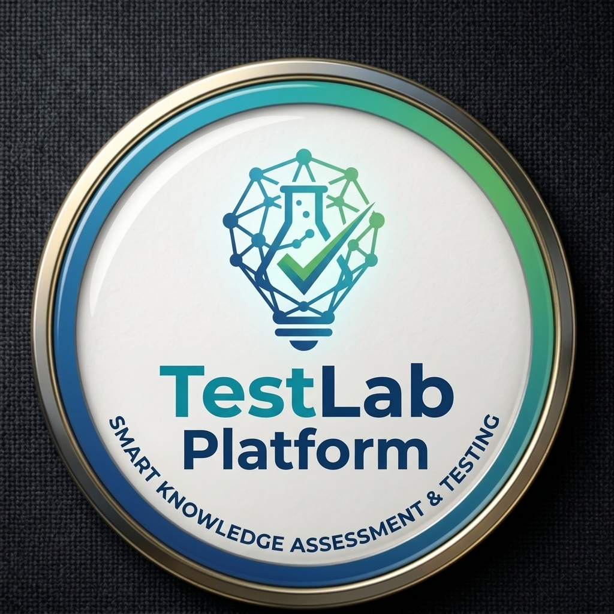

# 🧪 TestLab Platform — Smart Knowledge Assessment & Testing

<p align="center">
  
</p>

<p align="center">
  <b>Zamonaviy, xavfsiz va intellektual test tizimi</b><br>
  Telegram Bot + Telegram Mini App (Web App) + Gemini AI Savollar Tahlili
</p>

---

## 🌟 Asosiy Imkoniyatlar

### 👨‍🏫 O'qituvchilar uchun:
- **Tezkor test yaratish**: 100 tagacha savoldan iborat testlarni soniyalar ichida shakllantirish (rasmli va rasmsiz).
- **Sinflar (Classrooms)**: O'quvchilarni guruhlarga/sinflarga ajratish, har bir guruh bo'yicha alohida natijalarni kuzatish.
- **Monitoring rejimi**: Test yakunlangunga qadar kalitlarni yashirish va barcha topshiruvchilarni jonli kuzatib borish.
- **Excel hisobotlar**: Barcha topshiruvchilar va savollar kesimida to'liq tahliliy Excel jadvallarini generatsiya qilish.
- **Gemini AI tahlili**: Xato qilingan va murakkab savollarga sun'iy intellekt orqali avtomatik tushuntirish va yechimlar tayyorlash.

### 👨‍🎓 O'quvchilar uchun:
- **Telegram Mini App**: Chiroyli, zamonaviy va qulay Web App interfeysi orqali testlarni interaktiv yechish.
- **Anti-Cheat & Watermark**: Test varaqalariga o'quvchi ma'lumotlari bilan shaxsiy dinamik suv belgisi (watermark) tushirish.
- **Dinamik Sertifikatlar**: Yuqori ball to'plagan o'quvchilarga maxsus seriya raqami va tekshiruv QR kodi bo'lgan rasmiy sertifikatlar.
- **Xatolar tahlili**: Test yakunida har bir xato savolning to'g'ri javobi va tushuntirishini ko'rish imkoniyati.

---

## 🛠 Texnologiyalar Steki

- **Dasturlash tili**: Python 3.11+
- **Bot freymvorki**: [aiogram 3.15](https://docs.aiogram.dev/)
- **Mini App serveri**: [aiohttp 3.11](https://docs.aiohttp.org/)
- **Ma'lumotlar bazasi**: PostgreSQL (`asyncpg`) / SQLite (`aiosqlite`)
- **ORM va Migratsiyalar**: SQLAlchemy 2.0 (Async), Alembic
- **AI Integratsiyasi**: Google Gemini API
- **Media & Grafika**: Pillow (PIL), qrcode, openpyxl
- **Konteynerlashtirish**: Docker, Docker Compose

---

## 🚀 Loyihani Ishga Tushirish

### 1. Lokal muhitda (Development)

1. **Virtual muhit yaratish va kutubxonalarni o'rnatish**:
   ```bash
   python -m venv venv
   # Windows:
   venv\Scripts\activate
   # Linux / macOS:
   source venv/bin/activate

   pip install -r requirements.txt
   ```

2. **Muhit o'zgaruvchilarini sozlash**:
   `.env.example` faylidan nusxa olib, `.env` faylini yarating va tokenlarni kiriting:
   ```bash
   cp .env.example .env
   ```

3. **Botni ishga tushirish**:
   - Windows uchun: `start.bat` faylini ikki marta bosing yoki:
   ```bash
   python run.py
   ```

---

### 2. Barcha Sinovlarni (Tests) Ishga Tushirish

Loyiha to'liq 21 ta avtomatlashtirilgan test bilan qoplangan:

```bash
python tests/run_all.py
```

---

### 3. Serverga Joylashtirish (Production Deployment)

To'liq qo'llanma: [deploy/DEPLOY_GUIDE.md](deploy/DEPLOY_GUIDE.md)

#### Docker / Docker Compose orqali:
```bash
docker-compose -f deploy/docker-compose.yml up -d --build
```

#### Linux (Ubuntu VPS) orqali:
```bash
chmod +x deploy/setup.sh
./deploy/setup.sh
```

---

## 📂 Loyiha Tuzilishi

```
testlab/
├── apps/
│   ├── bot/                # Telegram bot (handlers, keyboards, middlewares)
│   └── webapp/             # Telegram Mini App serveri va static sahifalar
├── assets/                 # Logotiplar, shriftlar va statik resurslar
├── core/                   # Konfiguratsiya, logger, istisnolar
├── data/                   # Mahalliy SQLite DB va ma'lumotlar
├── deploy/                 # Docker, Nginx, Systemd va avtomatik o'rnatish skriptlari
├── modules/                # Biznes mantiq (assessment, catalog, media, classroom)
├── infrastructure/         # Ma'lumotlar bazasi dvigateli va ulanishlar
├── migrations/             # Alembic ma'lumotlar bazasi migratsiyalari
├── tests/                  # 21 ta keng qamrovli sinov testlari
├── Dockerfile              # Production Docker tasviri
├── requirements.txt        # Loyiha bog'liqliklari
└── run.py                  # Yagona ishga tushirish nuqtasi
```

---

## 🔒 Xavfsizlik

- Barcha maxfiy kalitlar va tokenlar `.env` faylida saqlanadi va Git tarixiga qo'shilmaydi.
- `.dockerignore` orqali keraksiz ma'lumotlar va maxfiy fayllar konteyner ichiga o'tishi cheklangan.
- Mini App `Telegram WebApp initData` HMAC-SHA256 tekshiruvi orqali to'liq himoyalangan.
